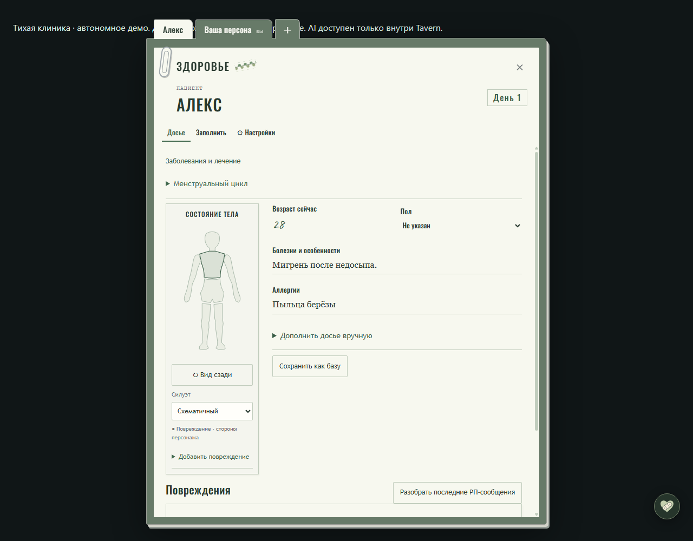

# Тихая клиника · Досье здоровья

Расширение SillyTavern, **0.5.0 beta**. Русский интерфейс, без сборки и сторонних библиотек.

Сверху досье открывается блок «Менструальный цикл» с галочкой для конкретной персоны. Активные болезни видны в блоке «Сейчас», история изменений находится внизу. Сердце открывает и закрывает окно.

Оформление: белая фактурная бумага, печатные графы Oswald и рукописные значения Caveat. Шрифты включены локально; лицензии SIL OFL находятся в `assets/fonts/`. Внешняя загрузка шрифтов не требуется.

## Установка и GitHub

Загрузите **содержимое** `health-journal` в корень отдельного репозитория: `manifest.json` должен лежать в корне. В Tavern → Расширения → Установить расширение укажите URL репозитория.

Локально: скопируйте папку в `SillyTavern/public/scripts/extensions/third-party/`, перезагрузите Tavern. Откройте чат и нажмите сердце с бинтом. Перемещение — мышь, палец или Alt + стрелки; сброс позиции в настройках.

Для AI выберите сохранённый профиль Connection Manager в настройках расширения. Нужна версия Tavern с `getContext().ConnectionManagerRequestService` и `loadWorldInfo`. Основное подключение чата не переключается.

Автономное демо: Node.js 22+ → `npm run demo` → http://127.0.0.1:8765/demo.html?demo . AI доступен только внутри Tavern. Через `file://` модули не запускаются.

## Возможности

- Досье участников текущего чата/группы и пользовательской персоны: возраст, болезни, аллергии, предрасположенности, заметки.
- Именные вкладки сверху; «+» добавляет локальную RP-персону (в том числе ребёнка) без карточки Tavern. Имя/возраст редактируются, вкладку можно убрать. Дополнительные персоны сохраняются только в этой истории.
- Силуэт спереди/сзади, девять зон включая спину и ягодицы, травмы и восстановление. Серьёзные повреждения завершаются вручную.
- Четыре темы: ботанический атлас, бумажное досье, бордовый архив, ночной кабинет. Акцент, размер текста, плотность, адаптация под телефон.
- Скан карточки и лорбука через отдельный профиль AI, генерация игровых предрасположенностей, ручное редактирование каждого результата.
- Настраиваемые правила заболеваний, обострений, факторов и восстановления; вероятности зависят от игрового времени, не числа сообщений.
- Цикл, игровой шанс беременности, ручной ввод срока, этапы развития, позднее появление симптомов и флаг знания персонажа.
- Журнал с отменой ручных правок и исключением ошибочных отметок модели; экспорт/импорт снимка досье.

## Скан здоровья

Загрузите карточку, встроенную/основную связанную книгу и при необходимости дополнительный лорбук. Выберите нужные источники, исключите записи о других персонажах. Дополнительные книги из расширенных привязок Tavern выбираются вручную. Отображаются активные записи книги, не только сработавшие в последнем промпте.

«Скан здоровья» и «Предрасположенности» делают по одному запросу через выбранный профиль. Результаты не применяются автоматически; источники показываются рядом, неизвестные ссылки помечены. AI может ошибаться. Генетические особенности — вымысел, не расчёт генома.

Найденная болезнь не включает случайные события молча: добавьте предложенное правило или создайте его в «Самочувствии». Локальный поиск по словам и случайные мягкие черты не вызывают AI.

Лимиты: до 300 источников, 8000 символов на запись книги, 10000 на поле карточки; общий выбранный текст сверяется с бюджетом запроса. Профиль и служебная инструкция идут сверх бюджета источников.

## Болезни и время

Начальные правила: мигрень, астма, аллергическая реакция, респираторная инфекция, инсульт и обобщённое тяжёлое заболевание. Можно создать своё: название, симптомы, категория, базовый риск, триггеры и длительность. Это небольшой игровой набор, не медицинский каталог.

Явно описанные в сцене болезнь, обращение за помощью, лечение и выздоровление попадают в досье через обычный ответ модели. Для записи нужна цитата из текущего обмена. Игрок также может начать эпизод вручную или бросить шанс. Бросок доступен один раз за игровой день для каждого заболевания. Подходящие воздействия повышают шанс. Болезнь с заданной длительностью проходит по игровому времени. При отметке лечения можно записать, что именно сделал персонаж. Эта запись появится в истории. «Отметить лечение» сокращает оставшийся срок вдвое один раз за игровой день. Если лечения не было, в конце эпизода возможен бросок на заданное игроком осложнение, которое продлевает болезнь на два игровых дня.

Опасные и потенциально смертельные события выключены по умолчанию, требуют добавленных правил. Автоматической смерти нет. Числа являются условными параметрами RP.

Время можно продвинуть в «Журнале» (до 3650 дней за операцию). Опционально основная модель добавляет в обычный ответ HTML-комментарий `<!--QH:{"v":2,"day":3,"timeQuote":"через три дня","events":[]}-->`. Расширение читает его локально, второго запроса нет. Модель может не соблюдать формат — остаётся ручной ввод. Отдельные сообщения `прошло 3 дня` / `таймскип: 2 недели` распознаются локально; также распознаётся отдельное «на следующий день». Досье показывает «День 1» в начале истории и часы от начала игрового дня. Для нового формата отметок переход времени требует цитаты.

В новых чатах отметка включена по умолчанию. Она передаёт новые травмы из последнего хода игрока и ответа модели, явное заживление, факторы и явно установленные репродуктивные события. Кнопка «Разобрать последние РП-сообщения» проверяет последние четыре сообщения отдельным запросом через профиль расширения. Для болезни, лечения, аллергии или непереносимости журнал сверяет цитату с текстом сцены. Повторная обработка не дублирует событие; редактирование/удаление/смена варианта пересчитывает историю. Если модель указала точную цитату, её можно раскрыть прямо под повреждением. Ручной разбор привязывает новую запись к сообщению с цитатой. При удалении сообщения или изменении соответствующего фрагмента запись исключается из текущей ветки. Модель может принять повторное упоминание в другом сообщении за новое событие — исключите ошибочную отметку в журнале. Изменение параметров симуляции может пересчитать прошлые события.

## Игровая наследственность

В досье можно однократно создать профиль предрасположенностей. Доступны встроенные и свои сюжетные черты. При создании профиля ребёнка можно выбрать двух родителей с готовыми профилями. Расширение делает отдельный бросок для каждой родительской черты. Вероятности задают игровые правила мира. Семейные черты для мигрени, астмы и чувствительности к пыльце умножают параметр соответствующего игрового броска на 1,5. Результат записывается при броске; создание генетического профиля само по себе не начинает болезнь. Уже созданные профили сохраняются.

## Цикл и беременность

Цикл включается независимо от силуэта: длина, менструация, начальный день, ощущения. Фазы расчётные, нерегулярность пока не моделируется. Это не календарь контрацепции.

Для взрослых персонажей: шанс после явного незащищённого акта с возможностью зачатия, учитывающий фазу и выбранный максимальный шанс. Требуются включённые цикл и вероятность. Эпизод можно добавить вручную; один эпизод вводите один раз. Беременность и срок также можно указать самостоятельно.

Акушерский срок: при игровом зачатии старт с 14 дней. Показаны недели, укрупнённые этапы развития и ориентир до 40 недель. Сразу после зачатия симптомы не включаются; с 4 акушерских недель допускаются неспецифические ощущения. До флага «персонаж знает» причина в сводке не раскрывается; игрок видит состояние. Основная модель может сделать собственную догадку из истории. Роды задаются вручную.

## Токены и данные

В новых чатах чтение времени и событий включено. Галочки времени и событий действуют независимо. Передачу сводки самочувствия можно включить отдельно. Для влияния на ответы включите передачу. Бюджет сводки — 1400 символов (настройка 300–6000), делится между персонажами; длинный текст обрезается. Инструкция времени и выходная отметка расходуют токены **сверх бюджета сводки**. Отдельные AI-запросы выполняются только по кнопкам скана/генерации. Счётчик показывает успешные запросы, не стоимость и не оплаченные неудачные попытки.

Настройки/базы: `extensionSettings.quietHealthJournal`; история: `chatMetadata.quietHealthJournal`; ID сообщений: `message.extra.quietHealthId`. Сохранение штатным сервером Tavern. Выбранные источники и профиль отправляются провайдеру выбранного AI-подключения. Других внешних запросов расширение не делает.

Базы связаны с файлами аватаров, пользовательская персона — с её аватаром (fallback по имени для старых версий). При переименовании используйте экспорт/импорт. «Сохранить базу» переносит постоянные сведения и правила в новые чаты без текущих травм/беременности. Состояния изолированы в metadata чата; ветки используют скопированную Tavern metadata. Ручные записи после удалённых сообщений исключаются из этой ветки с предупреждением. Старые сообщения до первого открытия автоматически не анализируются.

JSON-экспорт — снимок одного досье, без полного журнала. Исходные профили прототипа подхватываются как базы, оригинальные настройки сохраняются.

## Проверки и статус beta

`npm test` — логика и адаптеры API. `node tests/browser-check.mjs` — проверка демо при сервере и отдельном Chrome с debugging-портом 9224.

В 0.5.0 прошли 26 тестов логики и адаптеров и браузерные сценарии в Chrome. Проверены лечение и его история, наследование после перезагрузки, длинный текст на телефоне, доступность нижних кнопок в портретной и альбомной ориентации. Проверка внутри установленного SillyTavern с реальным ответом модели остаётся открытой.
